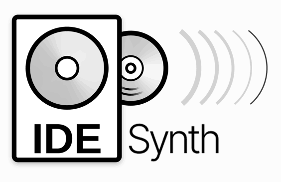
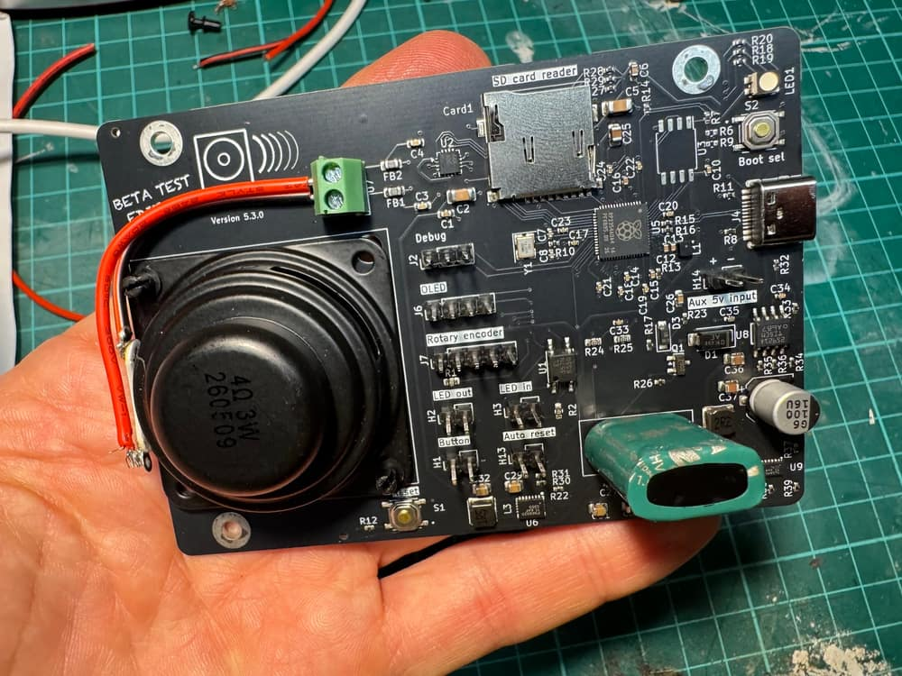
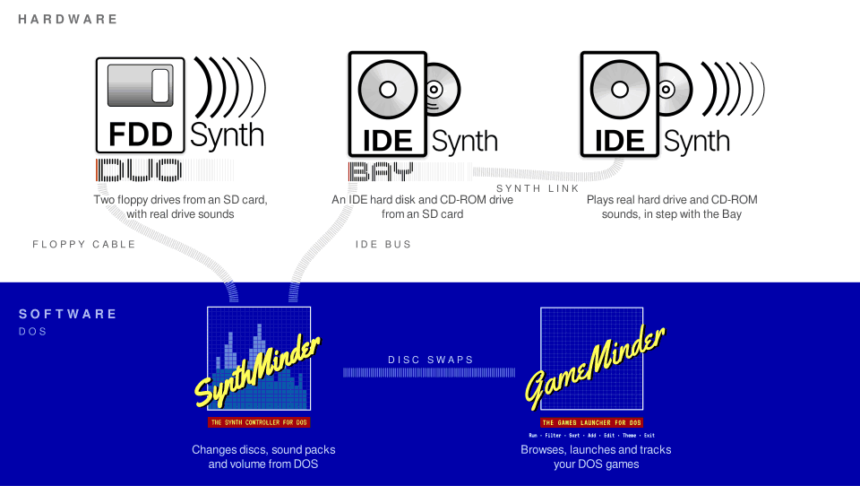

  

<h3 align="center">The sound of real mechanical drives, for retro PCs that use solid-state storage</h3>

  
  

**Status:** Currently with beta testers with planned public release in early 2027

<!-- Demo: replace the photo with a short video of the board in a PC, spinning up and seeking (GIF in the README, linking to the MP4). -->

  

## Features

- **Real drives, sampled:** spin-up at power on, the idle hum, access clicks and crackles and the spindown when the power goes, played from the board's supercapacitor. Swap sample packs to change the drive.
- **Drives modelled from physics:** a pack can be a synthesised drive instead of recordings, from a 1985 stepper to a 2005 7,200 rpm drive, tuned by ear in the online [Drive Lab](https://maverickuk.github.io/HDDSynth_Native/drive-lab/).
- **Knows what the drive is doing:** from the motherboard's HDD LED, from your modern computer over USB or exactly from an [IDE Synth Bay](https://github.com/MaverickUK/IDESynthBay): file copies sound different from random access, and the head goes where the PC really reads.
- **On the board:** volume and balance on a knob, a button for the next pack, an RGB activity light and an optional OLED screen.

## Quick start

1. **Flash the firmware:** download `.uf2` from the [latest release](https://github.com/MaverickUK/IDESynth/releases/latest), hold **BOOT** and tap **RESET**, then drag the file onto the `RP2350` drive that appears.
2. **Fill a microSD card:** put each sample pack in its own folder under `/samples` (packs are in [HDDSynth_Samples](https://github.com/MaverickUK/HDDSynth_Samples)) and put the card in the board.
3. **Fit it:** connect the motherboard's HDD LED header to the board's HDD LED input and power
4. **Turn the PC on:** the drive spins up. Press the action button for the next pack.

## Documentation

| Page | What it covers |
|---|---|
| [SD card setup](docs/sd-card.md) | Sample packs, WAV formats, `pack.json` and every `settings.json` key |
| [Synthesised drives](docs/modelled-drives.md) | `drive.json`: synthesised drives, presets and every parameter |
| [Controls, lights and screen](docs/controls.md) | The rotary encoder and action button, beeps and LED colours, the OLED, editing the card over USB |
| [The IDE Synth Bay link](docs/link.md) | Wiring and what the drive tells the synth: sequential transfers, head positions, its timing |
| [Companion app and protocol](docs/companion.md) | Your computer's disk activity over USB, and the serial sentences |
| [The hardware](docs/hardware.md) | The MK5 board, mounting, and the KiCad files |
| [How it works](docs/architecture.md) | The two cores, where each sound plays from, power loss |
| [Building and flashing](docs/building.md) | Building it yourself, tests, the serial console, versioning |
| [History](docs/history.md) | From breadboard to MK5, with the early videos |
| [Changelog](CHANGELOG.md) | Every release |

## The Synth family

  

- **IDE Synth** (this one): plays the sound of hard drives and optical drives, real drives sampled or modelled from physics, in step with the Bay
- [IDE Synth Bay](https://github.com/MaverickUK/IDESynthBay): an IDE hard disk and CD-ROM drive served from a microSD card, telling the IDE Synth exactly what it does
- [FDD Synth Duo](https://github.com/MaverickUK/FDDSynthDuo): two floppy drives served from a microSD card, with real drive sounds
- [SynthMinder](https://github.com/MaverickUK/SynthMinder): the synth controller for DOS, changing discs, sound packs and the volume from the PC they're fitted to
- [GameMinder](https://github.com/MaverickUK/GameMinder): the games launcher for DOS, which browses, launches and keeps track of your DOS games
- [HDDSynth_Samples](https://github.com/MaverickUK/HDDSynth_Samples): the sample packs

## Licence and credits

- **Software and firmware:** [GNU GPL v3.0](LICENSE).
- **Hardware designs** (schematics, PCB files, BOM): [CC BY-NC-SA 4.0](LICENSE-HARDWARE), free for personal, non-commercial use and changes; commercial use needs my permission.

Inspired by the [HDD Clicker](https://www.serdashop.com/HDDClicker). Thanks to [Ian Scott of PicoGUS](https://picog.us/) for sharing his knowledge of the Pico on the ISA bus, [Marten Electric](https://www.martenelectric.cz/) for their ISA prototyping boards, and [PCBWay](https://www.pcbway.com) for making and assembling the prototypes.

Peter Bridger · [strifestreams.com/hddsynth](https://www.strifestreams.com/hddsynth)
