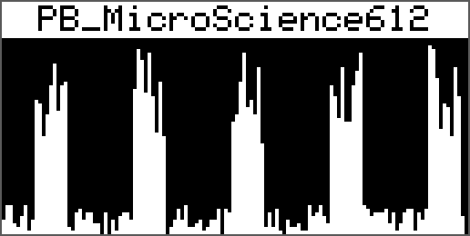
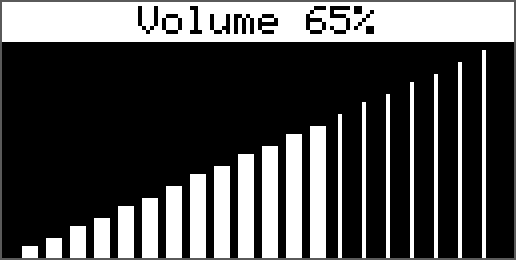
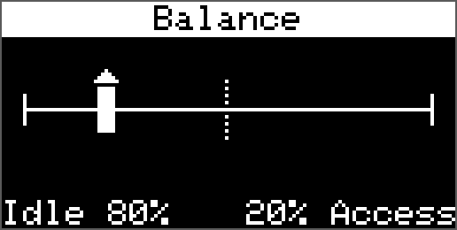
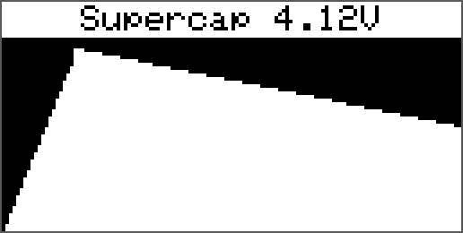
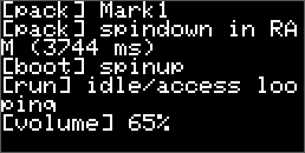

# Controls, lights and screen

The encoder and button, what the beeps and LED colours mean, the OLED, and editing the card over USB. Back to the [README](../README.md).

## Controls

- **Rotary encoder:** turn for volume (5% steps); press to switch to balance
  (10% steps) and back. Remembered across power cycles only with
  `SAVE_VOLUME_BALANCE`.
- **Action button:** held at power-on = share the SD card over USB (see
  [Editing the SD card over USB](#editing-the-sd-card-over-usb)). Short press (under 1 s) = next sample pack, remembered
  across power cycles. Hold 3 s = factory reset: forgets the chosen pack,
  the jingle flag and the saved volume/balance, then reboots. A press between 1 and 3 s does nothing.

## Lights and beeps

The RGB LED flashes in time with each beep: **blue** for something you
did, **red** for an error. Operation beeps are high-pitched, error beeps
low.

| Beeps | LED | Meaning |
|---|---|---|
| 2 short, high | 2 blue flashes | Encoder now adjusts **volume** |
| 3 short, high | 3 blue flashes | Encoder now adjusts **balance** |
| 1 short, high | 1 blue flash | Changing to the next sample pack |
| 1 long (1 s), high | 1 long blue flash | Factory reset, then a reboot |
| 1 low | red, repeating | **No SD card** (or it can't be read). Halted. |
| 2 low | red, repeating | **No sample packs** in `/samples`. Halted. |
| 4 low | red, repeating | **Broken pack**: `idle.wav`/`access.wav` missing or not 16 kHz mono 16-bit. Halted. Holding the action button 3 s (factory reset) forgets a saved broken pack. |
| 5 low | 5 red flashes, once | `SAMPLE_PACK` in settings.json **not found**. A warning: it carries on with another pack. |

"Halted" errors keep repeating their flash pattern on the red LED every
4 seconds, so a unit with no speaker attached still says what's wrong.
Beeps follow the volume setting, so they're never much louder than the drive
sound, but stay audible (at least 25%) even at very low volumes.

The rest of the time the RGB LED shows:

| LED | When |
|---|---|
| Activity colour (default green, `ACTIVITY_LED_COLOUR`) | HDD activity, real or simulated. Off when idle. `ACTIVITY_LED_ENABLED: false` turns this off. |
| A random colour per pack | HDD activity in demo mode. |
| Sequential colour (default orange, `SEQUENTIAL_LED_COLOUR`) | Sequential transfers reported by an IDE Synth Bay (`EXPERIMENTAL_HDDSYNTHPRO_SUPPORT`). |
| Rainbow, pulsing with the sound | While the jingle plays. |
| Off | During the spindown, and once power is lost. |

`RGB_LED_BRIGHTNESS` scales all of these. The separate external HDD LED
output (GP17) also lights on HDD activity.

## OLED display

An optional SSD1306 128x64 I2C OLED (e.g. The Pi Hut's 0.96" module, address
0x3C) plugs straight into header **J6**: pin 1 3.3 V, 2 GND, 3 SCL (GP25),
4 SDA (GP24). The board has no I2C pull-ups on J6; these modules carry their
own. Turn it on with `"OLED_ENABLED": true`. If no display answers, the boot
log says so and the firmware carries on without it.

`OLED_MODE` picks the main screen:

| Mode | Shows |
|---|---|
| `activity` (default) | The pack name in a title bar, and a graph of HDD activity: one column per `OLED_SAMPLE_MS`, its height the share of that time the drive was active. New columns appear on the right and push the rest left. |
| `supercap` | The same graph for the supercap voltage (full height = 4.2 V), with the current voltage in the title bar. |
| `debug` | The last 8 lines of console output (everything printed to the USB serial console). |

Whatever the mode, turning the **volume** or **balance** switches to a screen
for that level, which stays for 4 seconds after the last change. The display
switches off on power loss, to save the supercap's energy for the spindown.

| Activity | Volume | Balance |
|---|---|---|
|  |  |  |

| Supercap | Debug |
|---|---|
|  |  |

These are rendered by the host tests from the same drawing code the firmware
uses (with made-up data). To regenerate them:
`HDDSYNTH_PREVIEW_DIR=../docs/oled test/run_native_tests.sh && python3 test/pbm_to_png.py ../docs/oled`, from `firmware/`.

## Editing the SD card over USB

You don't need to take the card out to change packs or settings.json:

1. **Hold the action button while powering on** (or while tapping RESET),
   for about a second. The RGB LED turns **solid blue** and the OLED, if
   fitted, shows "USB drive". Or, from the serial console, type `u`: the
   board reboots straight into USB drive mode.
2. The SD card appears on the computer as a drive (named after the card's
   volume label). No audio plays in this mode.
3. Copy packs in, edit settings.json, and so on (about 450 KB/s each way).
4. **Eject the drive** on the computer. The board reboots into normal use
   with the changes. (Pressing the action button also reboots it; eject
   first so the computer has finished writing.)

macOS may spend a while indexing a newly shared card with Spotlight; an
eject waits until it has finished.
