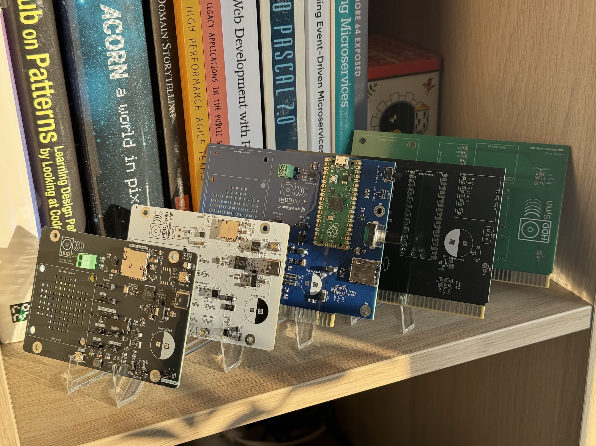
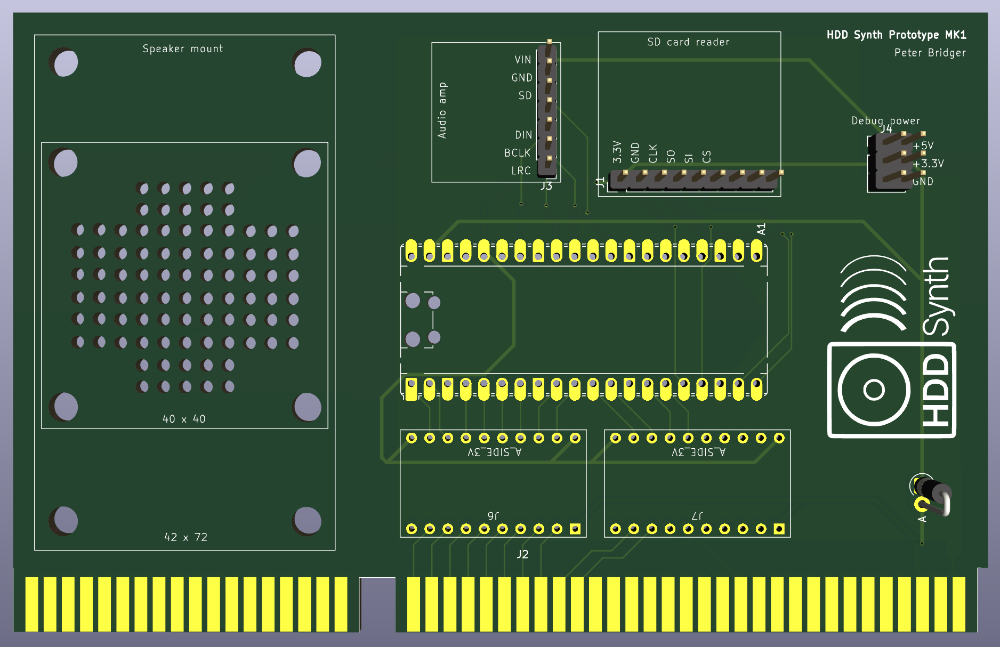
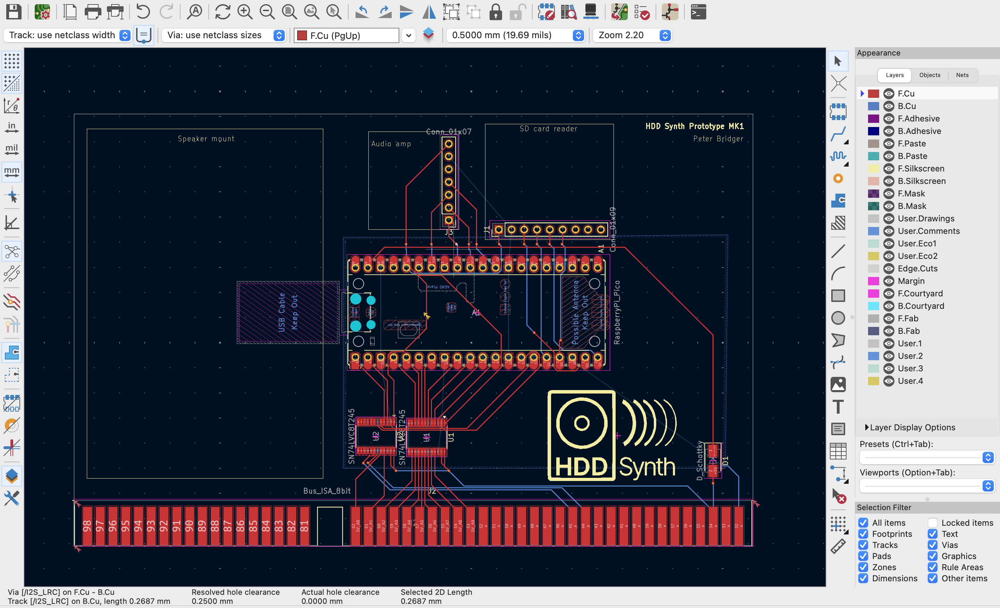
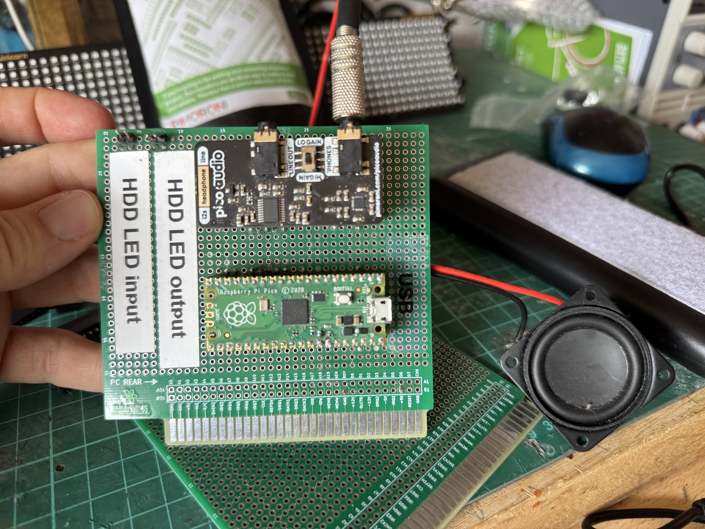

# History

How the IDE Synth came about, from a breadboard to the MK5 board. Back to the [README](../README.md).

## From HDD Synth to IDE Synth

The project started as the **HDD Synth**, inspired by the [HDD Clicker](https://www.serdashop.com/HDDClicker) and the wish to recreate old mechanical hard drives more faithfully: spinning up, idling and accessing data. Because the sounds come from samples, any drive recording, or something completely different, can be swapped in.

The first firmware was CircuitPython. [HDDSynth_Native](https://github.com/MaverickUK/HDDSynth_Native) replaced it with dual-core C++, which reached feature parity and then went further (modelled drives, the companion app, the link to an emulated drive).

It became the **IDE Synth** once it sounded like more than hard drives: with an [IDE Synth Bay](https://github.com/MaverickUK/IDESynthBay) it knows what every IDE device on the cable is doing, hard drives and optical drives alike. This repository brings together the MK5 hardware from [HDDSynth](https://github.com/MaverickUK/HDDSynth) and the firmware from HDDSynth_Native.

## Phase 2: PCB prototypes

The KiCad 3D render and layout of the MK1 board, the first PCB:

MK2 to MK5 followed, each made by [PCBWay](https://www.pcbway.com). MK5 is the board in this repository ([the hardware](hardware.md)).

## Phase 1: breadboard

**A powered ISA board:** an early board mounted inside the PC, taking power from the ISA bus's +5 V rail.

**HDD LED detection:** taking the activity from the voltage on the PC's HDD activity LED.

**The sound itself:** not yet connected to a PC, only to find out whether a Raspberry Pi Pico could make a convincing hard drive. It could.

